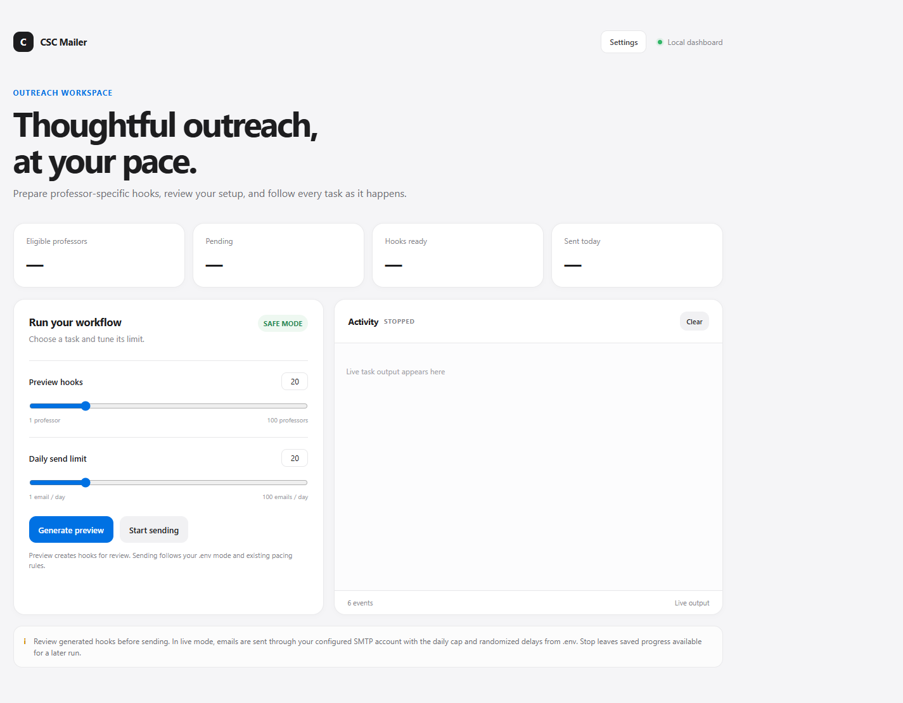

# ProfReacher

A Node.js workflow for sending personalised cold emails to professors as part of a CSC PhD application campaign. It reads professor records from a Google Sheet or local CSV, optionally enriches them with web research, generates a tailored opening hook with an LLM, stores manual approval decisions, and sends emails through SMTP with pacing safeguards.



*Dashboard preview; live professor counts and activity have been omitted from the screenshot.*

## What this project does

- Loads professor data from either:
  - a Google Sheet shared with public link access via `SHEET_CSV_URL`, or
  - a local CSV file via `CSV_PATH`
- Filters out invalid rows and already-applied professors
- Optionally uses OpenAlex, when enabled with an API key, to match a professor by name and institution and retrieve recent works/abstracts; optionally adds LangSearch web results
- Uses OpenRouter to generate a tailored hook paragraph using the combined research context
- Saves generated hooks in `hooks.json` for review and manual approval
- Builds a personalised email using prompt templates in `prompts/`
- Writes emails to `outbox/` in dry-run mode or sends them via SMTP in live mode
- Tracks progress in `state.json` so the run can safely pause and resume
- Enforces limits with a daily quota and randomized delays between sends

## Project structure

```text
ProfReacher/
├── .env.example
├── README.md
├── screenshots/
│   └── dashboard.png
├── prompts/
│   ├── email_body.txt
│   ├── email_signature.txt
│   ├── no_web.txt
│   ├── search_query.txt
│   ├── system.txt
│   └── user.txt
├── src/
│   ├── dashboard.html
│   ├── dashboard.js
│   ├── index.js
│   ├── openalex.js
│   ├── settings.html
│   ├── settings.js
│   └── ui.js
├── test/
│   └── openalex.test.js
├── package.json
└── package-lock.json
```

The app creates `.env`, uploaded files, generated hooks, send history, and progress data locally as needed. These files are Git-ignored and are not included in a fresh download.

## Requirements

- Node.js 18+
- A CSV or spreadsheet containing at least these columns:
  - `Name`
  - `University`
  - `Email`
  - `Profile Link`
  - `Research Interests`
  - `Applied`
- An SMTP sender account and CV file for live email sending
- An OpenRouter API key for hook generation (the default free router has rate and daily request limits)
- A LangSearch API key for additional web-assisted research (optional)

## Get started

No programming experience is required. The dashboard guides you through setup.

1. Install [Node.js 18 or newer](https://nodejs.org/). Git is optional if you download the project as a ZIP.
2. Get the project from [GitHub](https://github.com/zahqresh/ProfReacher). To use Git, open a terminal and run:

   ```bash
   git clone https://github.com/zahqresh/ProfReacher.git
   cd ProfReacher
   ```

   Alternatively, choose **Code → Download ZIP** on GitHub, extract it, and open a terminal in the extracted `ProfReacher` folder.
3. Install the app's dependencies:

   ```bash
   npm install
   ```

4. Start the dashboard:

   ```bash
   npm run ui
   ```

5. Open [http://127.0.0.1:4173](http://127.0.0.1:4173) in your browser. Keep the terminal window open while using the app; press `Ctrl+C` there when you want to stop the local dashboard.

The dashboard runs on your computer and listens only on `127.0.0.1`; it is not published to your network or hosted as a public website.

## Configure and use the app

1. Open **Settings** in the dashboard.
2. Add your professor list by uploading a CSV or entering a Google Sheets link. The CSV must include these headers: `Name`, `University`, `Email`, `Profile Link`, `Research Interests`, and `Applied`. For Google Sheets, set sharing to **Anyone with the link can view**.
3. Add an OpenRouter API key to generate personalized hooks. Create a key at [OpenRouter](https://openrouter.ai/keys). LangSearch and OpenAlex are optional research sources; each can be enabled in Settings when configured. OpenAlex keys are available at [OpenAlex API settings](https://openalex.org/settings/api).
4. Upload your CV if you intend to send live emails. For Gmail, create an App Password in your Google Account's Security settings and enter it in the SMTP password field; do not use your normal Google password.
5. Review the settings and choose **Save settings**. Settings are saved to `.env` on this computer; API keys and passwords are masked in the browser and `.env` is Git-ignored.
6. Return to the dashboard and choose **Generate preview**. Inspect the generated hooks and email drafts before sending. Safe mode is the default and saves drafts to `outbox/` without emailing anyone.
7. Only when you are ready to send real emails, change **Email mode** to **Live** in Settings, save, then choose **Start sending** and confirm the dashboard prompt. The daily limit and pacing safeguards still apply.

Open **Settings** at any time to update the list, credentials, research options, or safety settings. The `?` buttons explain individual fields.

### Optional future idea

A lightweight TODO list for tracking follow-up tasks (for example, reviewing a professor's hook or planning a follow-up) could be added in a future version. TODO tracking is not part of the current app.

## Manual configuration (optional)

For manual configuration, copy `.env.example` to `.env` first (`Copy-Item .env.example .env` in PowerShell). Most users can configure the app in the dashboard instead.

## Environment variables

Example configuration from `.env.example`:

```env
# Optional local dashboard port
PORT=4173

# Google Sheet or local CSV
SHEET_CSV_URL=
CSV_PATH=./professors.csv

CV_PATH=./your-cv.pdf
PROMPTS_DIR=./prompts

SMTP_HOST=smtp.gmail.com
SMTP_PORT=465
SMTP_USER=yourname@gmail.com
SMTP_PASS=xxxx xxxx xxxx xxxx
FROM_NAME=Your Name
SUBJECT=PhD application enquiry - Your Name

OPENROUTER_API_KEY=sk-or-...
OPENROUTER_BASE_URL=https://openrouter.ai/api/v1
OPENROUTER_MODEL=openrouter/free
USE_WEB_SEARCH=true
OPENALEX_ENABLED=false
OPENALEX_API_KEY=

LANGSEARCH_API_KEY=your-langsearch-api-key
SEARCH_COUNT=5

DAILY_LIMIT=20
MIN_DELAY_MIN=4
MAX_DELAY_MIN=11
MIN_RATING=0
SEND_LOW_CONFIDENCE=false
DRY_RUN=true
```

### Notes

- `SHEET_CSV_URL` should be a Google Sheet URL with public access, and the script converts it to CSV export automatically.
- `CSV_PATH` is used when no sheet URL is provided.
- `OPENALEX_ENABLED` controls OpenAlex and defaults to `false` when no key is configured. This integration requires `OPENALEX_API_KEY`, available for free from [OpenAlex API settings](https://openalex.org/settings/api); the key also increases the API budget and enables usage tracking. The app sends it as a bearer authorization header, looks up the institution, searches authors by name filtered by institution, and retrieves up to five recent works with abstracts when available. Uncertain institution matches are not attributed to the professor.
- `USE_WEB_SEARCH=true` additionally uses LangSearch and requires `LANGSEARCH_API_KEY`; it is independent of OpenAlex. When enabled, OpenAlex and LangSearch research contexts are combined in the prompt sent to OpenRouter. Both sources can be turned off.
- `DRY_RUN=true` keeps the script in safe mode and writes generated email drafts to `outbox/` instead of emailing anyone.
- `MIN_RATING` and `SEND_LOW_CONFIDENCE` are used to filter or hold low-fit or low-confidence hooks.
- The default `OPENROUTER_MODEL=openrouter/free` automatically selects an available free model. OpenRouter currently documents a 20 requests/minute limit for free models and a daily quota that depends on account credit status. The app checks the key's remaining free-model daily allowance before inference, spaces requests to stay below the per-minute limit, honors `Retry-After`, and retries temporary network, rate-limit, and server errors with backoff. The daily allowance may still be consumed by other apps using the same OpenRouter account/key. See [OpenRouter rate limits](https://openrouter.ai/docs/api-reference/limits); if the free quota is exhausted, wait for reset or select another model in Settings.

## Available commands

```bash
npm run preview -- 20
npm start
npm run status
npm run ui
```

### `npm run ui`

Starts the local web dashboard at `http://127.0.0.1:4173`. It is bound to loopback and is not exposed to your network.

The dashboard provides:

- Status cards for eligible, pending, hook-ready, and sent-today counts
- A preview slider to choose how many hooks to generate (1–100)
- A daily send-limit slider (1–100), applied to that dashboard run
- Real-time CLI output, task state, and a stop button
- A confirmation dialog before starting a live send when `DRY_RUN=false`

The dashboard runs the existing CLI commands as child processes; hook generation, review gates, SMTP behavior, pacing, and saved progress remain unchanged. When the daily quota is reached in live mode, the existing CLI waits for its next reset window; stop the task from the dashboard if you do not want it to continue later.

The dashboard uses port `4173` by default. Set `PORT` in Settings to use another local port; restart the dashboard after changing it.

Open **Settings** from the dashboard to configure the mailer without editing `.env` by hand. Settings are written to the local, Git-ignored `.env` file and loaded for future dashboard tasks. Saved SMTP and API credentials are never returned to the browser; leave a secret field blank to keep its current value, or select its remove option to clear it.

The Settings page explains each option with a `?` help button and supports:

- A Google Sheets link shared as **Anyone with the link can view**, with a remote access/header check
- Uploading a local CSV (maximum 4 MB), validated against the required column names: `Name`, `University`, `Email`, `Profile Link`, `Research Interests`, `Applied`
- Uploading a local CV PDF (maximum 15 MB) for live email attachments
- OpenRouter and LangSearch API keys, provider/model settings, SMTP sender details, prompt folder, email subject, web research, and pacing/safety values
- The optional OpenAlex author/works lookup and locally stored API key; OpenAlex is off by default until configured

Uploaded professor lists are stored as the Git-ignored `professors.csv`; uploaded CVs are stored as the Git-ignored `uploaded-cv.pdf`. Uploads remain in the project folder on this computer and are not sent to another service by the dashboard. The Google Sheet itself must be shared publicly by link because the current tool fetches its CSV export without Google sign-in.

### `npm run preview -- 20`

Generates hooks for the next 20 pending professors and writes them to `hooks.json`.

### `npm start`

Runs the email send cycle. In safe mode (`DRY_RUN=true`), it writes emails to `outbox/` and does not send anything. In live mode (`DRY_RUN=false`), it sends email and tracks progress in `state.json`.

### `npm run status`

Prints the current counts for pending, sent, failed, and hook-ready rows.

### `npm test`

Runs OpenAlex integration tests using mocked API responses; it does not call OpenAlex or use saved credentials.

## Workflow

1. Prepare your professor list in a Google Sheet or CSV.
2. Set the required variables in `.env`.
3. Run preview to generate hook entries:

```bash
npm run preview -- 20
```

4. Review and edit `hooks.json`.
   - Set `"approved": true` to force a hook to be sent.
   - Set `"approved": false` to reject it permanently.
   - Adjust the generated text if needed before live send.
5. Validate safely:

```bash
DRY_RUN=true
npm start
```

This writes formatted emails into `outbox/` instead of contacting professors.

6. When satisfied, switch to live mode:

```env
DRY_RUN=false
```

Then run:

```bash
npm start
```

The app will:
- respect `DAILY_LIMIT`
- pause between sends using random delays from `MIN_DELAY_MIN` to `MAX_DELAY_MIN`
- stop until the next daily reset window (roughly 5:00 AM PKT) when the daily quota is reached
- keep progress in `state.json` so it can resume safely

## `hooks.json` behavior

Each hook is keyed by professor email and includes fields such as:

- `hook`: the main tailored paragraph
- `short`: a shorter version
- `rating`: compatibility score from 0 to 10
- `reasons`: brief explanation
- `recommend_short`: whether a shorter message is preferred
- `confidence`: `high`, `medium`, or `low`
- `evidence`: cited paper or source information
- `approved`: manual override flag

Example:

```json
{
  "professor@example.edu": {
    "hook": "I have reviewed your research work in **machine learning**...",
    "short": "I have reviewed your work in ...",
    "rating": 8,
    "reasons": "Strong fit with ML and drug discovery research.",
    "recommend_short": false,
    "confidence": "high",
    "evidence": "https://example.edu/paper",
    "approved": true
  }
}
```

Rows are skipped automatically when:
- `Email` is missing or invalid
- `Name` is missing
- `Applied` is `TRUE`
- the hook is flagged as low confidence and `SEND_LOW_CONFIDENCE` is disabled
- the rating is below `MIN_RATING`
- the hook is marked `approved: false`

## State and logs

The application stores its progress in:

- `state.json` — tracks sent emails, failed attempts, and daily counters
- `sent_log.csv` — a log of successfully sent professors
- `outbox/` — dry-run email drafts

This makes the tool safe to interrupt and resume.

## Safety and operational notes

- Always run a dry-run test before live sending.
- Review `hooks.json` before launch; generated content should be checked for accuracy.
- Keep `DRY_RUN=true` until you are comfortable with the outgoing messages.
- The script is intended for a personal, controlled outreach workflow, not bulk unsolicited mass-mailing.

## License

This project is intended for personal use. License terms, if any, should be added by the repository owner.
